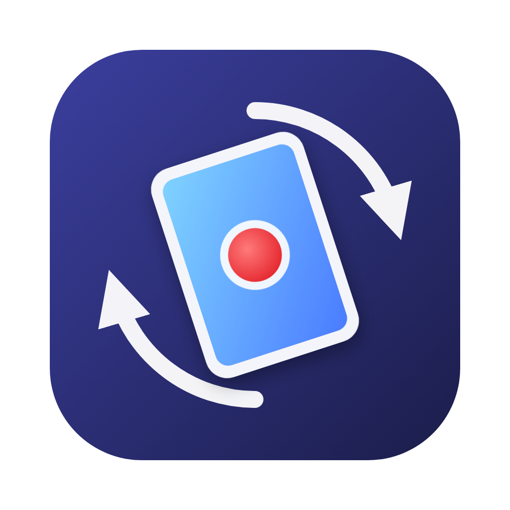

<p align="center"></p>

# PadCast

用 USB 線連接 iPad / iPhone，在 Mac 上即時預覽、錄影、錄音與截圖——跟 QuickTime 的「新增影片錄製」一樣，**再加上畫面旋轉與重播緩衝**。

適合直式畫面的遊戲：iPad 實際輸出是橫的，但遊戲把畫面直著呈現，用 PadCast 轉 90° 就能直接看、直接錄成直式影片。

## 功能

- **即時預覽**：色彩與 QuickTime 一致；滑鼠靜止或離開時，標題列、控制列與游標自動隱藏
- **錄影**：`.mov`，固定幀率（畫面沒變時也會補格），原生解析度
- **重播緩衝**：背景持續保留最近 30 秒～5 分鐘，打出精彩畫面後按「存重播」（⇧⌘R）就存檔
- **畫面旋轉**：左轉／右轉 90°，錄影、重播與截圖都照旋轉後的方向輸出
- **畫質選項**：H.264／HEVC、30／60 fps、低／中／高畫質（設定面板或「錄影」選單）
- **麥克風**：可同時錄 Mac 麥克風，存成獨立音軌（預設關閉）
- **監聽**：從 Mac 喇叭播放 iPad 聲音，可調音量（不影響錄進檔案的音量）
- **視窗置頂**開關、全螢幕
- **狀態顯示**：錄影中右上角顯示時間與檔案大小（不會跟著介面隱藏）；剩餘空間低於 5 GB 警告，低於 500 MB 自動停止錄影
- **記住設定**：旋轉方向、視窗位置大小、音量與所有開關，下次打開維持原樣
- **截圖**：轉正後的 PNG

檔案儲存在 `~/影片/PadCast/`（選單「錄影 → 打開輸出資料夾」，⇧⌘O）。

## 快捷鍵

| 動作 | 快捷鍵 |
|---|---|
| 開始／停止錄影 | ⌘R |
| 儲存重播 | ⇧⌘R |
| 截圖 | ⇧⌘S |
| 向左／向右旋轉 | ⌘← ／ ⌘→ |
| 視窗置頂 | ⌘T |
| 全螢幕 | ⌃⌘F |
| 監聽音量 ±10% | ⌘↑ ／ ⌘↓ |
| 監聽靜音 | ⇧⌘M |
| 設定 | ⌘, |

## 建置

需要 macOS 13 以上，以及 Xcode 或 Command Line Tools（`xcode-select --install`）。

```bash
./build.sh
open PadCast.app
```

或直接在 Finder 雙擊 `建置並開啟.command`。

也可以到 [Releases](../../releases) 下載 GitHub Actions 自動建置好的 `PadCast.zip`（universal，Apple Silicon／Intel 都能用）。這個 App 沒有經過 Apple 公證，第一次開啟請在 App 上按右鍵 →「打開」，或執行：

```bash
xattr -dr com.apple.quarantine PadCast.app
```

第一次開啟時請允許「相機」與「麥克風」權限，iPad 要解鎖並信任這台電腦。

## 測試

錄影引擎有自動測試，不需要 iPad：用合成的畫面（包含畫面靜止的片段）、聲音與麥克風跑過整條管線，再檢查輸出檔的長度、幀率、是否掉格、編碼、音軌數與旋轉資訊，也測試重播緩衝的分段接縫與暫存檔清理。

```bash
./Tests/run-tests.sh      # 或雙擊 Tests/run-tests.command
```

## 程式結構

| 檔案 | 內容 |
|---|---|
| `Sources/main.swift` | 程式進入點 |
| `Sources/AppDelegate.swift` | App 流程：裝置連線、錄影／重播／截圖、設定套用、狀態顯示 |
| `Sources/MainWindow.swift` | 視窗、浮動控制列、自動隱藏、選單 |
| `Sources/SettingsPanel.swift` | 設定面板 |
| `Sources/Views.swift` | 預覽畫面、滑鼠追蹤、錄影指示標籤 |
| `Sources/Recorder.swift` | 擷取管線：送給預覽、一般錄影與重播緩衝 |
| `Sources/SegmentWriter.swift` | 寫入單一影片檔（固定幀率、iPad 音軌、麥克風音軌） |
| `Sources/ReplayExporter.swift` | 合併重播分段並輸出 |
| `Sources/Settings.swift` | 偏好設定與畫質參數 |
| `Sources/Util.swift` | 共用工具 |
| `Tests/` | 錄影引擎自動測試 |

## 自動建置

`.github/workflows/build.yml`：每次 push 到 `main` 都會在 macOS runner 上編譯並跑測試，結果在該次 Actions 的 Artifacts。在 GitHub 網頁上發佈 Release（或推送 `v` 開頭的 tag）會自動建置並附上 `PadCast.zip`。

## 注意事項

- 同一時間只能有一個程式擷取 iPad 畫面，使用前請先關閉 QuickTime、OBS 等。
- 錄影中不能旋轉（旋轉資訊在開始錄影時寫入檔案）；重播則套用「存重播」當下的方向。
- 畫質與麥克風設定在下一次開始錄影（重播緩衝則是下一段）時生效。
- 麥克風音軌是獨立的第二條音軌，QuickTime 會兩條一起播放，剪輯軟體裡可以分開調整。
- 開啟視窗置頂時無法進入全螢幕（系統限制）。
- 受 DRM 保護的內容（如部分串流影片）會是黑畫面，這是系統限制。
- 除錯紀錄寫在 App 旁邊的 `debug.log`。

## 原理

macOS 的 CoreMediaIO 有一個開關 `kCMIOHardwarePropertyAllowScreenCaptureDevices`，打開後已連線的 iOS 裝置會以 `AVCaptureDevice`（影音合一的 muxed 裝置）出現。之後就是標準的 AVFoundation：`AVCaptureSession` 取得畫面與聲音，`AVSampleBufferDisplayLayer` 預覽，`AVAssetWriter` 寫檔。

- **固定幀率**：每格畫面先複製到自己的緩衝區池，再由計時器以固定間隔寫出，畫面沒變時補上重複影格。
- **重播緩衝**：背景每 10 秒切一段小檔，只保留足夠涵蓋最近 N 秒的分段；存檔時用 `AVMutableComposition` 接起來，不重新編碼直接輸出。
- **旋轉**：寫在影片軌的 transform 裡，畫面本身不需要轉向。

## 授權

[The Unlicense](LICENSE)——公眾領域，可任意使用、修改、散布，不需標示出處。
